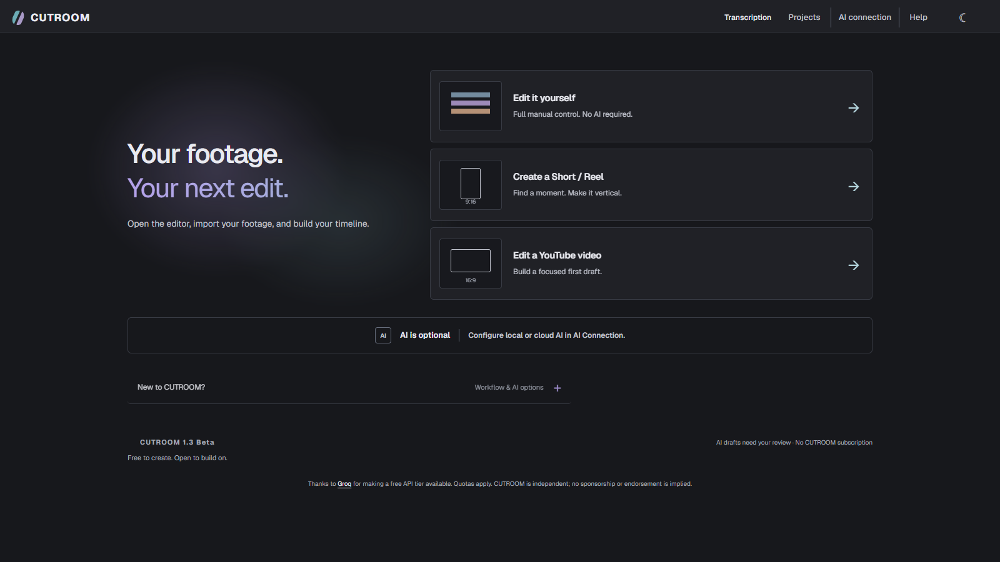
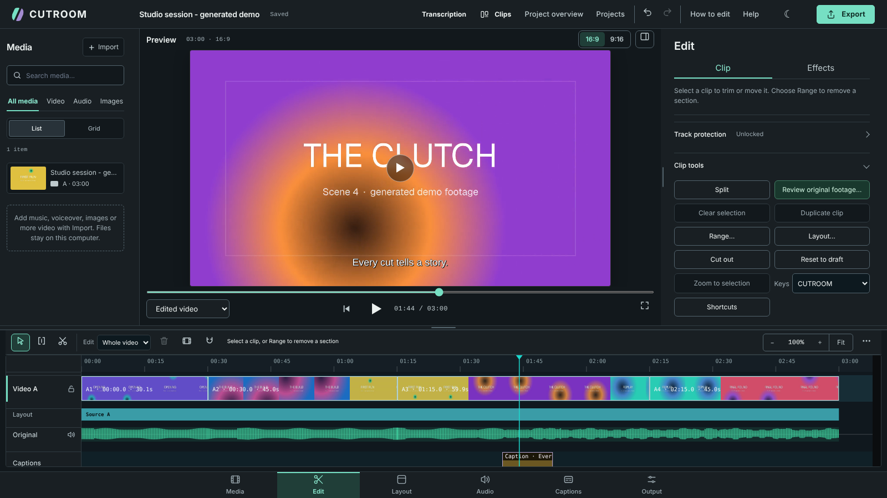
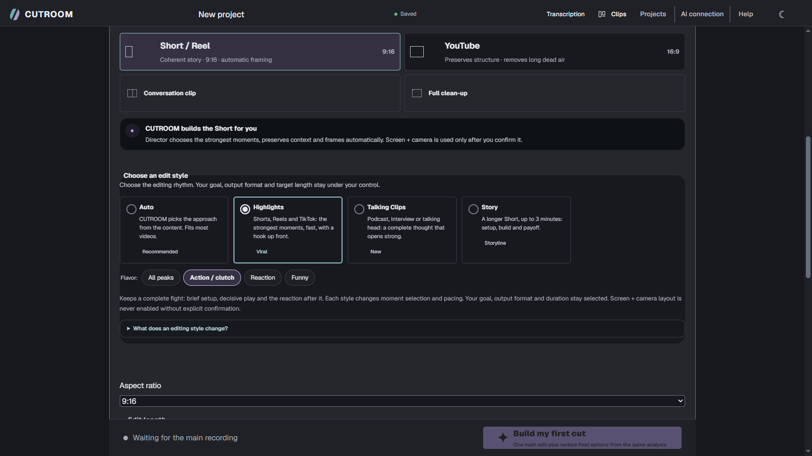
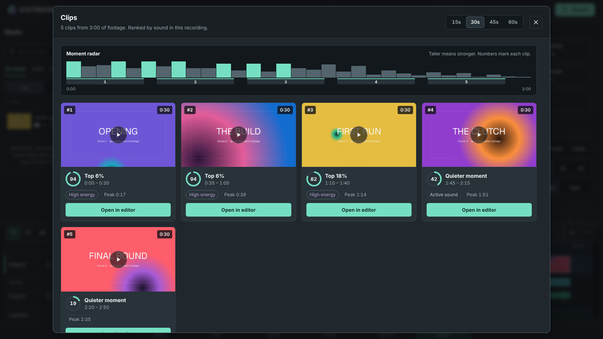

# CUTROOM

**A free, open-source video editor for recordings, YouTube, Shorts and Reels.**
Cut, frame, mix and caption on your computer. Start manually or generate a first draft and decide what stays.

[Download for Windows or Mac](https://cutroom-studio.expo.app/#download) · [GitHub releases](https://github.com/VanoPeradze/cutroom/releases) · [User guide](docs/USER_GUIDE_EN.md) · [עברית](docs/README_HE.md)

## The editor

Click any screenshot to open the same PNG at its original size. These are real CUTROOM screens using synthetic demo material or an empty test project, not AI mockups. [Full gallery and capture dates](docs/GALLERY.md).

<table>
  <tr>
    <td> Home</td>
    <td> Editor</td>
  </tr>
  <tr>
    <td> Edit styles</td>
    <td> Clips board</td>
  </tr>
</table>

## What it does

- **Manual editing:** Trim and arrange your clips, frame A/B video, mix audio, and add captions. You don't need an account or AI.
- **Clips:** Review 15, 30, 45 or 60-second suggestions, then export individual or multiple mapped ranges as local MP4s. Copy suggested titles, description and hashtags; CUTROOM does not publish to social platforms.
- **AI-assisted drafts:** Choose a Short, a conversation clip or a longer YouTube edit. This source organizes styles into five families with variants. Its optional local video map estimates things like speaker changes and sound events to help review; estimates and suggested chapters can be wrong.

## Start editing

1. Download **CUTROOM 1.3 Beta** from the [website](https://cutroom-studio.expo.app/#download). Extract the whole ZIP into a new folder.
2. On Windows, run `START CUTROOM.bat`. On Mac, open `mac` inside the combined ZIP and run `START CUTROOM.command` beside `App`. [Linux is source-only](docs/PLATFORMS.md#linux-source-based-development-path).
3. Choose **Edit it yourself**, import a video, make a small edit, and export. Start with a copy of a short recording and watch the finished MP4.

First-time setup needs internet. Local speech and Story AI require separate models; configured cloud AI is optional. The source-note field and detailed video map stay local. See [AI connections](docs/AI_CONNECTIONS.md), [known beta limits](docs/BETA_STATUS.md) and the exact checks on each [release](https://github.com/VanoPeradze/cutroom/releases).

[Changelog](CHANGELOG.md) · [Report an issue](https://github.com/VanoPeradze/cutroom/issues) · [MIT license](LICENSE)
