<p align="center">
  <a href="docs/images/showcase/cover-20261106.jpg">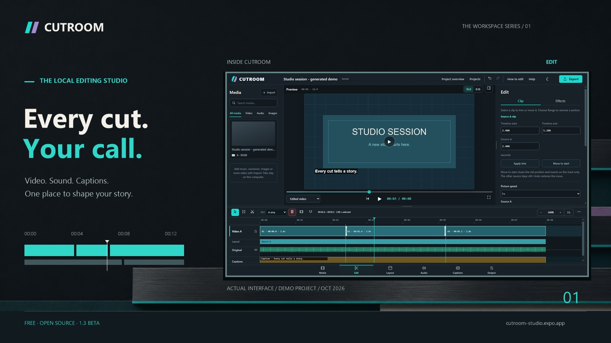</a>
</p>

<p align="center">
  <strong>A free, local-first video editor for YouTube, Shorts and Reels.</strong><br>
  Cut your recording, frame every shot, mix the sound and add captions.<br>
  Start by hand, or let optional AI draft a first cut that you review and change.
</p>

<p align="center">
  <a href="CHANGELOG.md"></a>
  <a href="docs/BETA_STATUS.md"></a>
  <a href="LICENSE"></a>
  <a href="docs/PLATFORMS.md"></a>
  <a href="docs/AI_CONNECTIONS.md"></a>
</p>

<p align="center">
  <a href="https://cutroom-studio.expo.app/"><strong>Website</strong></a> ·
  <a href="https://github.com/VanoPeradze/cutroom/releases"><strong>Windows releases</strong></a> ·
  <a href="https://github.com/VanoPeradze/cutroom/releases"><strong>Mac releases</strong></a> ·
  <a href="docs/USER_GUIDE_EN.md">User guide</a> ·
  <a href="docs/README_HE.md">Hebrew README</a>
</p>

**Click any image to open that exact file at full size.** The Home and editor cards use unaltered demo screenshots from 19 October 2026; original PNGs are linked below each card. These are interface previews, not a capture of the latest release or a demonstration of AI editing quality. [Screenshot dates and coverage](docs/GALLERY.md) · [Artwork and provenance](docs/images/showcase/README.md)

## Contents

[1.3 Beta update](#13-beta-update) · [Highlights](#highlights) · [Quick start](#quick-start) · [How it works](#how-it-works) · [AI, your way](#ai-your-way) · [Privacy](#privacy) · [Requirements](#requirements) · [Beta status](#beta-status) · [Documentation](#documentation) · [Contributing and support](#contributing-and-support) · [License and credits](#license-and-credits)

## 1.3 Beta update

The November 11 revision adds a neutral-gray light theme and safer local Hebrew refinement, plus mixed Hebrew/Latin caption rendering fixes. Dark mode and video colors are unchanged. See the [changelog](CHANGELOG.md) for exact behavior and validation limits.

CUTROOM 1.3 Beta gives added videos their detected source sound by default, with mute and gain controls. Existing silent overlays keep their saved choice. The AI draft notice expands in the inspector, leaving the preview clear. Compact layouts, preview recovery and FFmpeg compatibility are improved. See the [changelog](CHANGELOG.md) for source-review and timeline updates; each [release](https://github.com/VanoPeradze/cutroom/releases) identifies its exact source and recorded checks.

## Highlights

- **Six focused workspaces.** Media, Edit, Layout, Audio, Captions and Output share one player and one timeline.
- **Independent A/B tracks.** Cut, trim and move a camera and a screen recording together or separately, with Undo/Redo and track locks. [Timeline controls](docs/INDEPENDENT_TRACKS.md)
- **Camera and screen layouts.** Stacked, side by side, picture in picture, camera only or screen only, for a selected range or the entire edit.
- **Track mixer.** Balance Original, Music, Voiceover, Effects and Master with live level meters. Mute applies to preview and export; Solo is for preview only.
- **Text and captions.** Add titles and captions, import SRT or VTT, and correct and style an optional AI transcript.
- **Green screen and stabilization.** Apply a chroma key to any video source, or create an optional stabilized local copy. [Green screen](docs/CHROMA_KEY.md) · [Stabilization](docs/STABILIZATION.md)
- **Local MP4 export.** Landscape, vertical, square, portrait or the source shape, from 720p to 4K at up to 60 FPS, with no CUTROOM watermark.
- **Gameplay vision for Shorts.** A compatible installed local Story model looks at sampled frames to propose action moments and filter menus and loading screens. Frames stay on your computer. [Models](docs/MODELS.md#gameplay-vision)
- **AI is optional.** Manual editing needs no AI model, API key or account.

<table>
  <tr>
    <td width="50%"><a href="docs/images/showcase/home-20261106.jpg">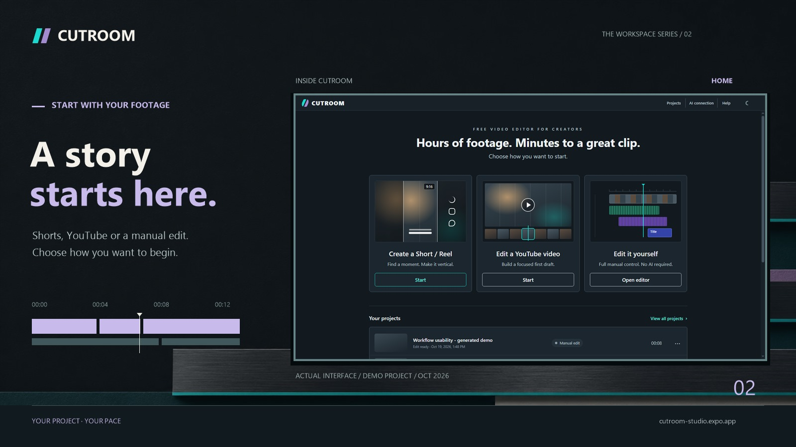</a></td>
    <td width="50%"><a href="docs/images/showcase/media-20261106.jpg">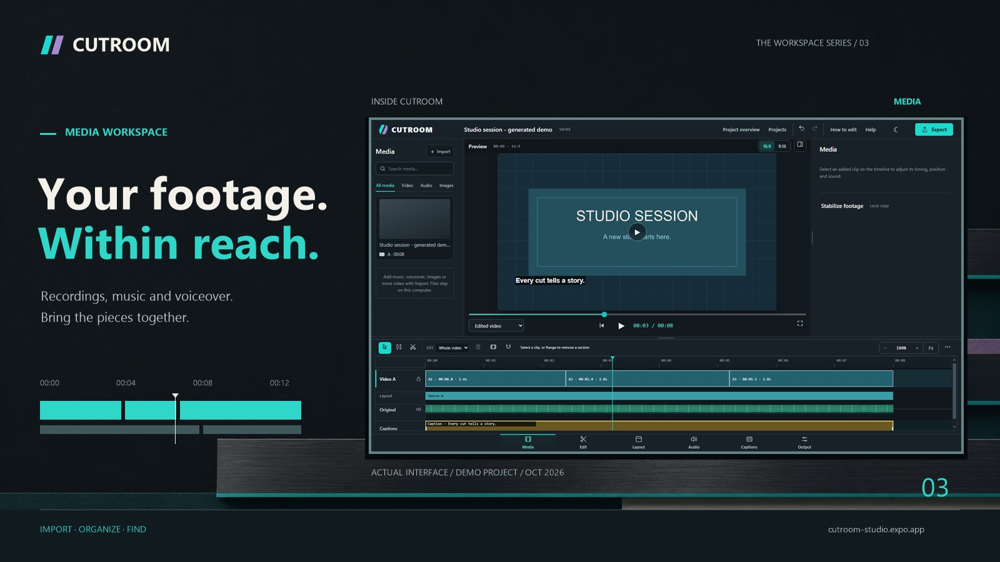</a></td>
  </tr>
  <tr>
    <td align="center"><strong>Home</strong> · <a href="docs/images/readme/studio-home-20261019.png">Original PNG</a></td>
    <td align="center"><strong>Media</strong> · <a href="docs/images/readme/studio-media-20261019.png">Original PNG</a></td>
  </tr>
  <tr>
    <td><a href="docs/images/showcase/edit-20261106.jpg">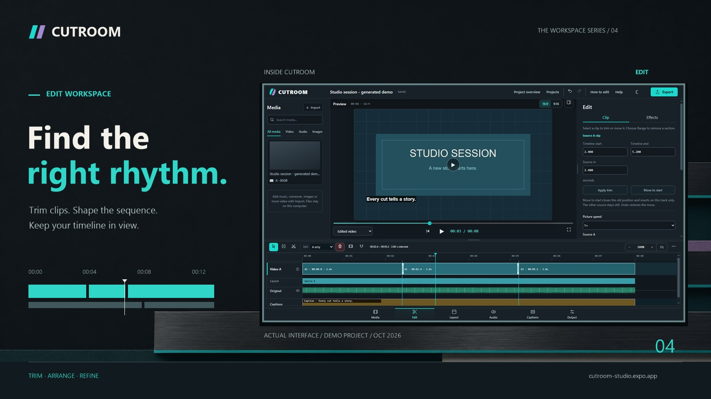</a></td>
    <td><a href="docs/images/showcase/layout-20261106.jpg">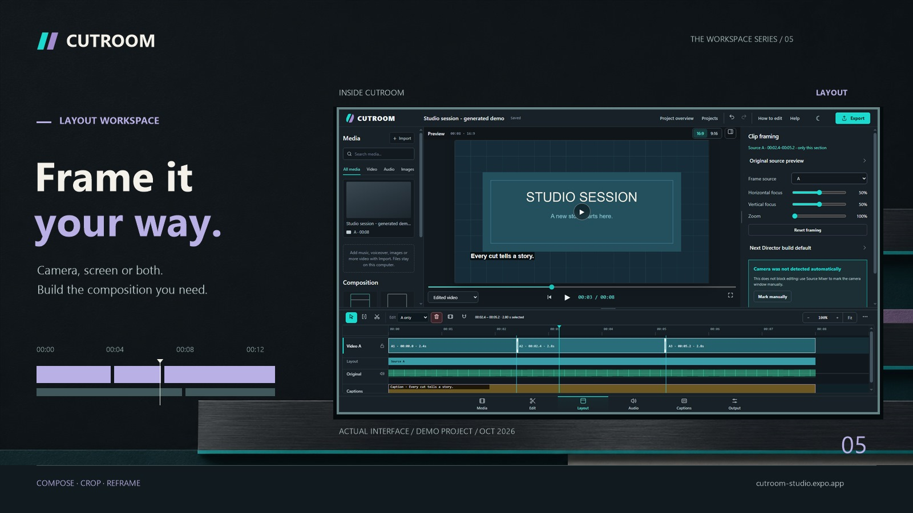</a></td>
  </tr>
  <tr>
    <td align="center"><strong>Edit</strong> · <a href="docs/images/readme/studio-edit-20261019.png">Original PNG</a></td>
    <td align="center"><strong>Layout</strong> · <a href="docs/images/readme/studio-layout-20261019.png">Original PNG</a></td>
  </tr>
  <tr>
    <td><a href="docs/images/showcase/audio-20261106.jpg">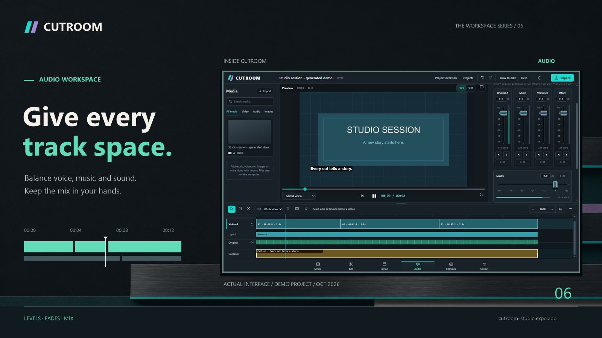</a></td>
    <td><a href="docs/images/showcase/captions-20261106.jpg">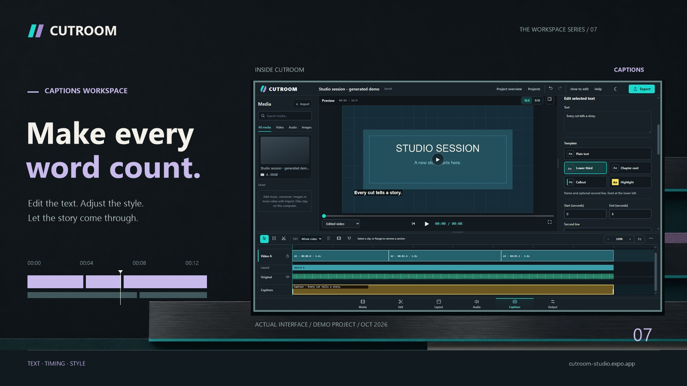</a></td>
  </tr>
  <tr>
    <td align="center"><strong>Audio</strong> · <a href="docs/images/readme/studio-audio-20261019.png">Original PNG</a></td>
    <td align="center"><strong>Captions</strong> · <a href="docs/images/readme/studio-captions-20261019.png">Original PNG</a></td>
  </tr>
  <tr>
    <td><a href="docs/images/showcase/output-20261106.jpg">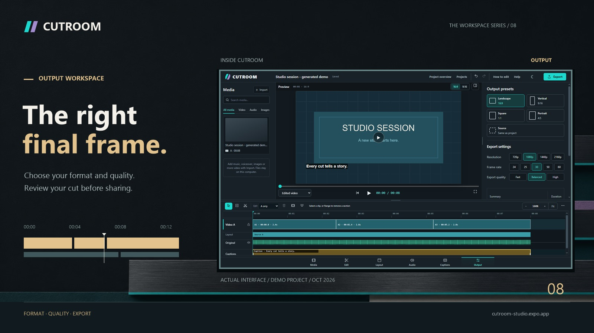</a></td>
    <td><a href="docs/images/showcase/ai-20261106.jpg">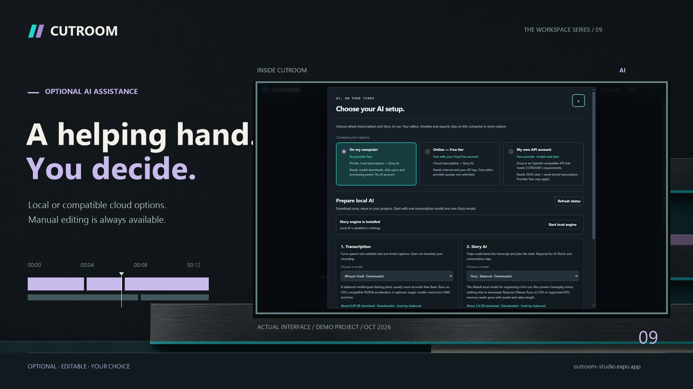</a></td>
  </tr>
  <tr>
    <td align="center"><strong>Output</strong> · <a href="docs/images/readme/studio-output-20261019.png">Original PNG</a></td>
    <td align="center"><strong>AI connection</strong> · <a href="docs/images/ai-options.png">Original PNG</a></td>
  </tr>
  <tr>
    <td><a href="docs/images/readme/studio-projects-20261015.png">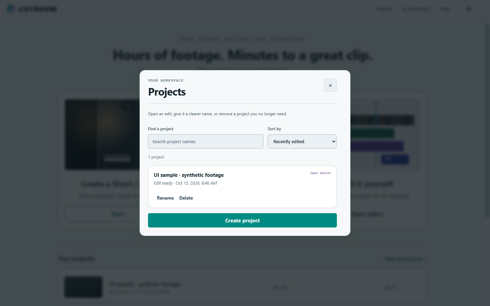</a></td>
    <td><a href="docs/images/readme/studio-export-dialog-20261015.png">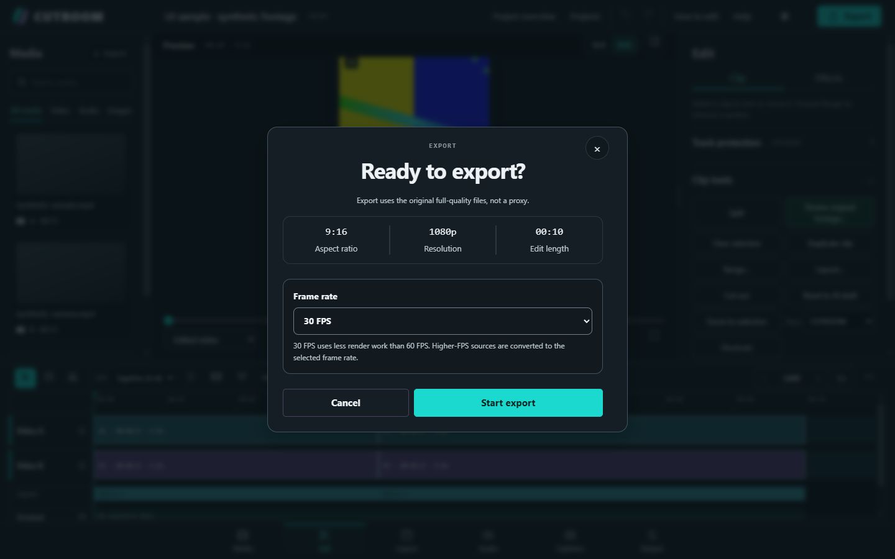</a></td>
  </tr>
  <tr>
    <td align="center"><strong>Projects</strong> · <sub>15 October 2026</sub></td>
    <td align="center"><strong>Export confirmation</strong> · <sub>15 October 2026</sub></td>
  </tr>
</table>

These ten views are the authentic captures currently available; the AI capture date is unrecorded. The [full window checklist](docs/GALLERY.md#current-source-coverage-checklist) identifies dialogs and states still awaiting fresh screenshots.

## Quick start

### Download for Windows or macOS

| Platform | Download | Launcher |
| --- | --- | --- |
| **Windows** | [Windows releases](https://github.com/VanoPeradze/cutroom/releases) | **START CUTROOM.bat** |
| **macOS** | [Mac releases](https://github.com/VanoPeradze/cutroom/releases) | **START CUTROOM.command** |

1. Extract the entire ZIP into a fresh folder. Keep **App**, **START HERE.html** and the launcher together.
2. Open the launcher beside **App** and let setup finish. In a combined ZIP, open **windows** or **mac** first.
3. Edit in your browser. Keep the launch window open while you work; closing the browser alone does not stop CUTROOM.

**These are source-based beta packages. First setup needs internet.** Python, FFmpeg, the local Story engine and AI models are not bundled. If the browser does not open, use the address shown in the launch window. The Mac launcher is unsigned; the [platform guide](docs/PLATFORMS.md) explains setup and security prompts.

> [!IMPORTANT]
> Before the first Windows launch, make sure WinGet is available and install the [official Microsoft Visual C++ x64 runtime](https://aka.ms/vc14/vc_redist.x64.exe). The CUTROOM launcher does not install this prerequisite.

The [releases page](https://github.com/VanoPeradze/cutroom/releases) includes source identities, recorded checks and SHA-256 sidecars. Downloads can differ from the current repository. To update, extract a fresh copy separately and back up projects before moving them. The [18 October beta](https://github.com/VanoPeradze/cutroom/releases/tag/v1.2-beta-20261018) remains available for rollback.

### Run from source

- **Windows:** run `run_windows.bat` from the repository root.
- **macOS:** follow the [Mac setup guide](https://github.com/VanoPeradze/cutroom/blob/master/docs/MAC_BETA.md).
- **Linux:** install **Python 3.12** with `venv` and `pip`, **FFmpeg/FFprobe** and **Bash**, then run:

```sh
chmod +x setup_linux.sh run_linux.sh
bash setup_linux.sh
bash run_linux.sh
```

Setup creates a local virtual environment and installs the Python dependencies. FFmpeg needs the encoding and subtitle filters listed in the [Linux prerequisites](docs/PLATFORMS.md#linux-source-based-development-path).

## How it works

1. **Bring your footage.** Start with one recording, or add a camera and a screen recording as sources A and B.
2. **Build your edit.** Edit by hand, or review an AI-assisted YouTube cleanup or Short/Reel draft.
3. **Make it yours.** Trim and arrange clips, adjust framing and sound, add captions, then export an MP4 and watch the result.

The library stays on the left, the preview in the centre, properties on the right and the timeline below. Select a clip or caption to open its tools. Imported audio has per-clip volume and fades; Audio controls whole mixer groups. Drag a divider, or focus it and use the arrow keys, to resize the workspace.

| Workspace | What you do there |
| --- | --- |
| **Media** | Import recordings, images, music and voiceover. Search and filter the project library. Your original files stay untouched. |
| **Edit** | Split, trim, move and restore clips. Protect a track with a lock. Apply a green screen in **Effects**. |
| **Layout** | Choose the composition, assign camera and screen roles, set the framing and adjust the sync offset. |
| **Audio** | Mix Original, Music, Voiceover, Effects and Master with live meters, Mute and Solo. |
| **Captions** | Add text and captions, import SRT or VTT, correct the transcript and style the subtitles. |
| **Output** | Choose the shape, resolution, frame rate and quality, then export. |

[User guide](docs/USER_GUIDE_EN.md) · [Keyboard shortcuts](docs/KEYBOARD_SHORTCUTS.md) · [Shortcut profiles](docs/KEYBOARD_PROFILES.md)

## AI, your way

| Mode | What it does | What it needs |
| --- | --- | --- |
| **Manual editing** | You make the cuts, add media and captions, and export. | No AI model, API key or account. |
| **Local AI** | Transcribes speech and proposes an edit using models on your computer. | Separate model downloads, disk space and processing time. Story AI needs a separate local engine. |
| **Cloud AI (optional)** | Uses Groq or a compatible provider for transcription and edit planning. | Your own API account, compatible models and your explicit consent. Provider limits and billing apply. |

- **You stay in control.** A new AI draft does not replace your manual timeline until you choose **Apply new AI draft**, and Undo stays available.
- **Plan for model downloads.** Auto mode uses stronger transcription and Story models when already installed and supported by available GPU memory. A missing selected speech model can download on first use. [Download behavior](docs/THIRD_PARTY_NOTICES.md)
- **Know your limits.** Mac transcription currently runs on the CPU. A chat subscription does not include API access, and free tiers have usage limits.

[AI connections and privacy](docs/AI_CONNECTIONS.md) · [Models and download sizes](docs/MODELS.md)

## Privacy

- **Local work.** Editing, preview and MP4 export run on your computer. Projects and working media are stored locally.
- **Cloud AI only with consent.** When cloud AI is enabled, selected audio is sent to your provider for transcription, and transcript text and editing context for planning. Video frames are not sent. The provider's retention and privacy terms apply.
- **No CUTROOM account.** There is no CUTROOM subscription, account or export watermark.

## Requirements

| Platform | Status |
| --- | --- |
| **Windows** | Source-based beta ZIP with launcher. WinGet and the Microsoft Visual C++ x64 runtime are prerequisites; see [Quick start](#quick-start). Physical-device coverage remains pending. |
| **macOS** | Source-based Mac beta ZIP for macOS 15 or later on Apple Silicon and Intel. Finder, Gatekeeper and Safari behavior still need manual verification; see the dated release for automated checks. |
| **Linux** | Source checkout only: Python 3.12, FFmpeg/FFprobe and Bash. No Linux download, and the full Linux installation is not yet verified end to end. |

See the [platform guide](docs/PLATFORMS.md) for exact prerequisites, commands and troubleshooting.

## Beta status

CUTROOM 1.3 Beta is beta software. Start with a short recording, keep your originals, and review captions, AI selections, synchronization, sound and the exported MP4 before publishing. AI drafts need your review; the default YouTube cleanup keeps your recording's order.

With two recordings, confirm that both sources show the same moment. A camera appears only where its track has footage. Added media and custom text do not generally follow source reordering; **Together → Close gaps** moves them with the edit. Saved transcript-caption corrections follow surviving source speech. See [timeline controls and limits](docs/INDEPENDENT_TRACKS.md).

Automated checks and synthetic renders do not prove real-footage quality or installation on every computer. Exact package checks belong to each [dated release](https://github.com/VanoPeradze/cutroom/releases); physical-device setup, Mac security prompts and representative English/Hebrew editing remain in the [manual acceptance protocol](https://github.com/VanoPeradze/cutroom/blob/master/packaging/REVIEW_ACCEPTANCE.md).

[Beta status](docs/BETA_STATUS.md) · [Known limits](docs/QUALITY_AND_LIMITS.md) · [Mac validation](https://github.com/VanoPeradze/cutroom/blob/master/docs/MAC_BETA.md) · [Changelog](CHANGELOG.md)

## Documentation

| Guide | Covers |
| --- | --- |
| [User guide](docs/USER_GUIDE_EN.md) · [Hebrew user guide](docs/USER_GUIDE_HE.md) | The complete editing workflow |
| [Platform setup](docs/PLATFORMS.md) | Windows, macOS and Linux installation and troubleshooting |
| [AI connections](docs/AI_CONNECTIONS.md) · [Models](docs/MODELS.md) | Local and cloud AI, privacy, model sizes |
| [Timeline controls](docs/INDEPENDENT_TRACKS.md) | Working with sources A and B |
| [Green screen](docs/CHROMA_KEY.md) · [Stabilization](docs/STABILIZATION.md) | Effects and their limits |
| [Keyboard shortcuts](docs/KEYBOARD_SHORTCUTS.md) | Commands and shortcut profiles |
| [Test on another PC](docs/TEST_ON_ANOTHER_PC.md) | First-run checks and common setup problems |
| [All guides](docs/README.md) | The full documentation index |

## Contributing and support

- **Found a problem?** [Open an issue](https://github.com/VanoPeradze/cutroom/issues/new/choose) with your operating system, browser, steps to reproduce and a short, redacted error message. The [tester feedback guide](docs/BETA_FEEDBACK.md) explains what helps most.
- **Want to contribute?** Start with [development setup and checks](docs/CONTRIBUTING.md) and the [contribution guidelines](.github/CONTRIBUTING.md). CUTROOM is built with Python, plain JavaScript and FFmpeg.
- **Security issue?** Please follow the private process in the [security policy](.github/SECURITY.md) instead of opening a public issue.

## License and credits

CUTROOM is released under the **[MIT License](LICENSE)**. Third-party tools and AI models keep their own licenses; see the [third-party notices](docs/THIRD_PARTY_NOTICES.md).

Thanks to the open-source projects behind CUTROOM, including FFmpeg, faster-whisper, ivrit.ai and the local Story engine listed in the [third-party notices](docs/THIRD_PARTY_NOTICES.md). CUTROOM is independent of external AI providers.
