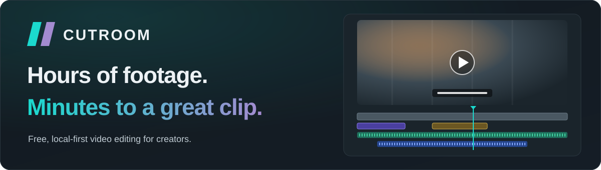
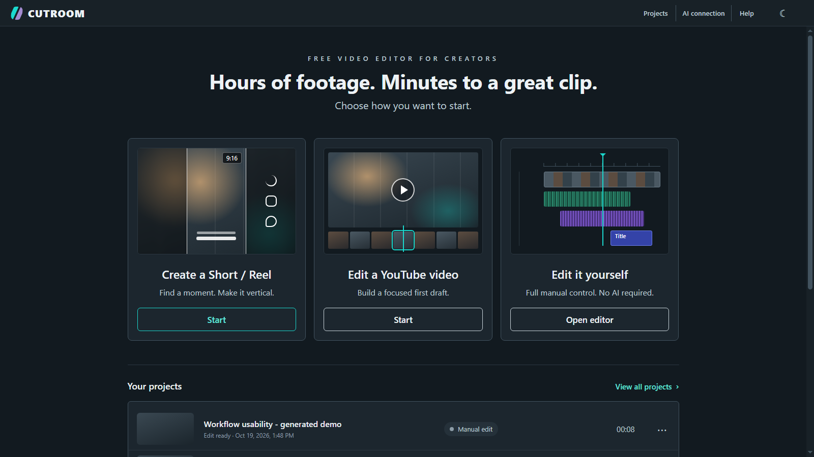
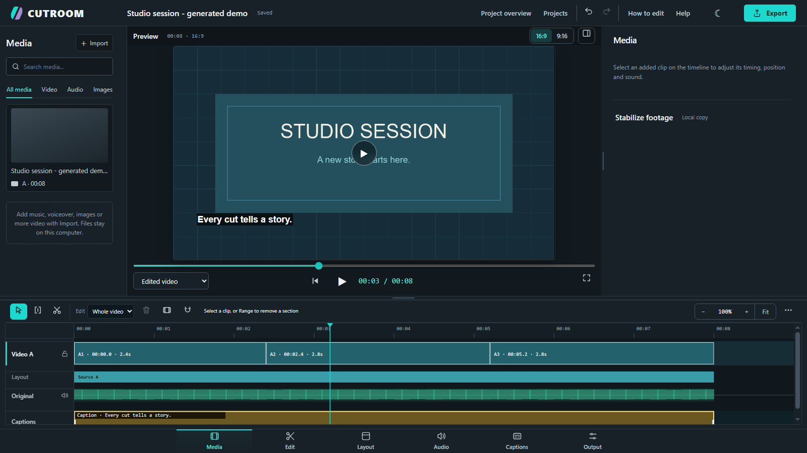
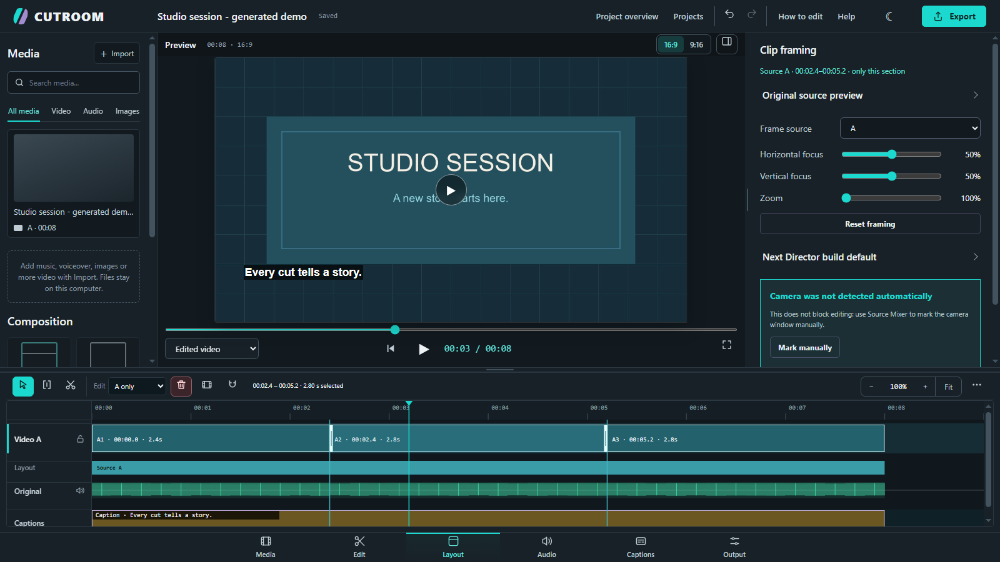
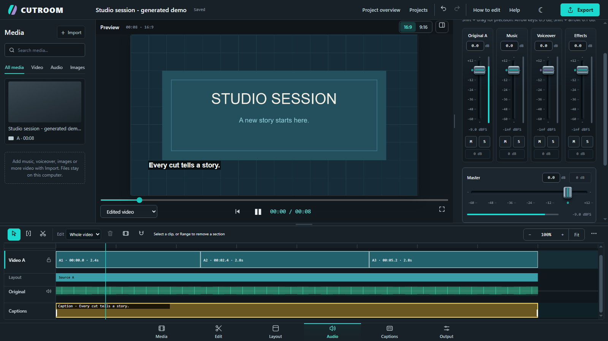
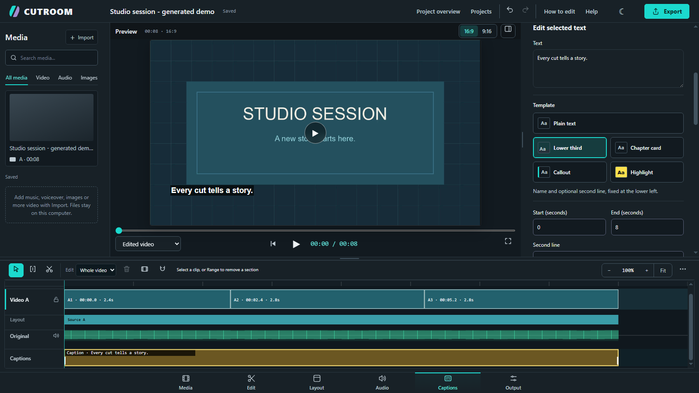
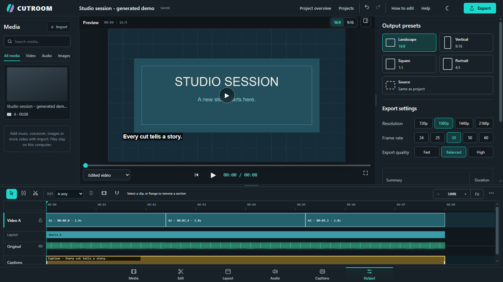

<p align="center">
  
</p>

<p align="center">
  <strong>A free, local-first video editor for YouTube, Shorts and Reels.</strong><br>
  Cut your recording, frame every shot, mix the sound and add captions.<br>
  Start by hand, or let optional AI draft a first cut that you review and change.
</p>

<p align="center">
  <a href="CHANGELOG.md"></a>
  <a href="docs/BETA_STATUS.md"></a>
  <a href="LICENSE"></a>
  <a href="docs/PLATFORMS.md"></a>
  <a href="docs/AI_CONNECTIONS.md"></a>
</p>

<p align="center">
  <a href="https://cutroom-studio.expo.app/"><strong>Website</strong></a> ·
  <a href="https://github.com/VanoPeradze/cutroom/releases/download/v1.2-beta-20261019-hotfix1/CUTROOM-1.2-Beta-Windows-20261019-hotfix1.zip"><strong>Download for Windows</strong></a> ·
  <a href="https://github.com/VanoPeradze/cutroom/releases/download/v1.2-beta-20261019-hotfix1/CUTROOM-1.2-Beta-Mac-20261019-hotfix1.zip"><strong>Download for Mac</strong></a> ·
  <a href="docs/USER_GUIDE_EN.md">User guide</a> ·
  <a href="docs/README_HE.md">Hebrew README</a>
</p>

<p align="center">
  <a href="docs/images/readme/studio-edit-20261019.png"></a>
</p>

Captured on **19 October 2026**, the screenshots show the actual editor with an original generated STUDIO SESSION demo and procedural audio. They demonstrate the interface, not AI editing quality.

## Contents

- [Highlights](#highlights)
- [Quick start](#quick-start)
- [How it works](#how-it-works)
- [AI, your way](#ai-your-way)
- [Privacy](#privacy)
- [Requirements](#requirements)
- [Beta status](#beta-status)
- [Documentation](#documentation)
- [Contributing and support](#contributing-and-support)
- [License and credits](#license-and-credits)

## Highlights

- **Six focused workspaces.** Media, Edit, Layout, Audio, Captions and Output share one player and one timeline.
- **Independent A/B tracks.** Cut, trim and move a camera and a screen recording together or separately, with Undo/Redo and track locks. [Timeline controls](docs/INDEPENDENT_TRACKS.md)
- **Camera and screen layouts.** Stacked, side by side, picture in picture, camera only or screen only, for a selected range or the entire edit.
- **Track mixer.** Balance Original, Music, Voiceover, Effects and Master with live level meters. Mute applies to preview and export; Solo is for preview only.
- **Text and captions.** Add titles and captions, import SRT or VTT, and correct and style an optional AI transcript.
- **Green screen and stabilization.** Apply a chroma key to any video source, or create an optional stabilized local copy. [Green screen](docs/CHROMA_KEY.md) · [Stabilization](docs/STABILIZATION.md)
- **Local MP4 export.** Landscape, vertical, square, portrait or the source shape, from 720p to 4K at up to 60 FPS, with no CUTROOM watermark.
- **Gameplay vision for Shorts.** A compatible installed local Story model looks at sampled frames to propose action moments and filter menus and loading screens. Frames stay on your computer. [Models](docs/MODELS.md#gameplay-vision)
- **AI is optional.** Manual editing needs no AI model, API key or account.

<table>
  <tr>
    <td width="50%"><a href="docs/images/readme/studio-home-20261019.png"></a></td>
    <td width="50%"><a href="docs/images/readme/studio-media-20261019.png"></a></td>
  </tr>
  <tr>
    <td align="center"><sub>Home</sub></td>
    <td align="center"><sub>Media</sub></td>
  </tr>
  <tr>
    <td><a href="docs/images/readme/studio-layout-20261019.png"></a></td>
    <td><a href="docs/images/readme/studio-audio-20261019.png"></a></td>
  </tr>
  <tr>
    <td align="center"><sub>Layout</sub></td>
    <td align="center"><sub>Audio</sub></td>
  </tr>
  <tr>
    <td><a href="docs/images/readme/studio-captions-20261019.png"></a></td>
    <td><a href="docs/images/readme/studio-output-20261019.png"></a></td>
  </tr>
  <tr>
    <td align="center"><sub>Captions</sub></td>
    <td align="center"><sub>Output</sub></td>
  </tr>
</table>

## Quick start

### Download for Windows or macOS

1. Download the [Windows ZIP](https://github.com/VanoPeradze/cutroom/releases/download/v1.2-beta-20261019-hotfix1/CUTROOM-1.2-Beta-Windows-20261019-hotfix1.zip) or the [Mac ZIP](https://github.com/VanoPeradze/cutroom/releases/download/v1.2-beta-20261019-hotfix1/CUTROOM-1.2-Beta-Mac-20261019-hotfix1.zip).
2. Extract the entire archive and open the folder containing **App** and the launcher.
3. Open the launcher beside the **App** folder: **START CUTROOM.bat** on Windows, **START CUTROOM.command** on macOS.
4. CUTROOM opens in your browser. Keep the launch window open while you edit; closing the browser alone does not stop CUTROOM.

**These are source-based beta packages. First setup needs internet** to install dependencies. Python, FFmpeg, the local Story engine and AI models are not bundled. Keep **App**, **START HERE.html** and the launcher together. If the browser does not open, copy the address shown in the launch window once setup finishes. The Mac launcher is unsigned and is not a signed or notarized `.app`; the [platform guide](docs/PLATFORMS.md) explains the security prompts.

> [!WARNING]
> Before the first Windows launch, make sure WinGet is available and install the [official Microsoft Visual C++ x64 runtime](https://aka.ms/vc14/vc_redist.x64.exe). The CUTROOM launcher does not install this prerequisite. See the [platform guide](docs/PLATFORMS.md) for setup and troubleshooting.

[Release notes](https://github.com/VanoPeradze/cutroom/releases/tag/v1.2-beta-20261019-hotfix1). The [18 October beta](https://github.com/VanoPeradze/cutroom/releases/tag/v1.2-beta-20261018) remains available for rollback. To update, extract a fresh copy separately and back up your projects before moving them.

This hotfix addresses a Windows export failure after fresh setup selected FFmpeg 9.0.2. Setup and rendering now verify supported graph-file and constant-frame-rate options. See the release notes for the exact tested packages and remaining acceptance limits.

The release includes SHA-256 sidecars for the [Windows ZIP](https://github.com/VanoPeradze/cutroom/releases/download/v1.2-beta-20261019-hotfix1/CUTROOM-1.2-Beta-Windows-20261019-hotfix1.zip.sha256), [Mac ZIP](https://github.com/VanoPeradze/cutroom/releases/download/v1.2-beta-20261019-hotfix1/CUTROOM-1.2-Beta-Mac-20261019-hotfix1.zip.sha256) and [combined ZIP](https://github.com/VanoPeradze/cutroom/releases/download/v1.2-beta-20261019-hotfix1/CUTROOM-1.2-Beta-20261019-hotfix1.zip.sha256). The [dated release notes](https://github.com/VanoPeradze/cutroom/releases/tag/v1.2-beta-20261019-hotfix1) identify the exact app source and recorded checks.

An optional [Windows + Mac ZIP](https://github.com/VanoPeradze/cutroom/releases/download/v1.2-beta-20261019-hotfix1/CUTROOM-1.2-Beta-20261019-hotfix1.zip) contains both platforms. Open **windows** or **mac** inside it before launching.

### Run from source

- **Windows:** run `run_windows.bat` from the repository root.
- **macOS:** follow the [Mac setup guide](https://github.com/VanoPeradze/cutroom/blob/master/docs/MAC_BETA.md).
- **Linux:** install **Python 3.12** with `venv` and `pip`, **FFmpeg/FFprobe** and **Bash**, then run:

```sh
chmod +x setup_linux.sh run_linux.sh
bash setup_linux.sh
bash run_linux.sh
```

Setup creates a local virtual environment and installs the Python dependencies. FFmpeg needs the encoding and subtitle filters listed in the [Linux prerequisites](docs/PLATFORMS.md#linux-source-based-development-path).

## How it works

1. **Bring your footage.** Start with one recording, or add a camera and a screen recording as sources A and B.
2. **Build your edit.** Edit by hand, or review an AI-assisted YouTube cleanup or Short/Reel draft.
3. **Make it yours.** Trim and arrange clips, adjust framing and sound, add captions, then export an MP4 and watch the result.

The project library stays on the left, the preview in the centre, properties on the right and the timeline below. Click footage or a caption in the timeline to open its tools. Select imported audio to adjust that clip's volume and fades; the Audio workspace adjusts whole mixer groups. Drag a divider, or focus it and use the arrow keys, to resize the preview, timeline and properties. Compact windows use a scrolling layout.

| Workspace | What you do there |
| --- | --- |
| **Media** | Import recordings, images, music and voiceover. Search and filter the project library. Your original files stay untouched. |
| **Edit** | Split, trim, move and restore clips. Protect a track with a lock. Apply a green screen in **Effects**. |
| **Layout** | Choose the composition, assign camera and screen roles, set the framing and adjust the sync offset. |
| **Audio** | Mix Original, Music, Voiceover, Effects and Master with live meters, Mute and Solo. |
| **Captions** | Add text and captions, import SRT or VTT, correct the transcript and style the subtitles. |
| **Output** | Choose the shape, resolution, frame rate and quality, then export. |

[User guide](docs/USER_GUIDE_EN.md) · [Keyboard shortcuts](docs/KEYBOARD_SHORTCUTS.md) · [Shortcut profiles](docs/KEYBOARD_PROFILES.md)

## AI, your way

| Mode | What it does | What it needs |
| --- | --- | --- |
| **Manual editing** | You make the cuts, add media and captions, and export. | No AI model, API key or account. |
| **Local AI** | Transcribes speech and proposes an edit using models on your computer. | Separate model downloads, disk space and processing time. Story AI also needs a separate local engine; CUTROOM links to its installer. |
| **Cloud AI (optional)** | Uses Groq or a compatible provider for transcription and edit planning. | Your own API account, compatible models and your explicit consent. Provider limits and billing apply. |

- **You stay in control.** A new AI draft does not replace your manual timeline until you choose **Apply new AI draft**, and Undo stays available.
- **Plan for model downloads.** In Auto mode, CUTROOM uses the stronger transcription and Story models only when they are already installed and your graphics card has room for them. It suggests a larger Story model when it would fit. Models are separate downloads; a missing selected speech model can download on its first use. [Download behavior](docs/THIRD_PARTY_NOTICES.md)
- **Know your limits.** Mac transcription currently runs on the CPU. A chat subscription does not include API access, and free tiers have usage limits.

[AI connections and privacy](docs/AI_CONNECTIONS.md) · [Models and download sizes](docs/MODELS.md)

## Privacy

- **Local work.** Editing, preview and MP4 export run on your computer. Projects and working media are stored locally.
- **Cloud AI only with consent.** When cloud AI is enabled, selected audio is sent to your provider for transcription, and transcript text and editing context for planning. Video frames are not sent. The provider's retention and privacy terms apply.
- **No CUTROOM account.** There is no CUTROOM subscription, account or export watermark.

## Requirements

| Platform | Status |
| --- | --- |
| **Windows** | Source-based beta ZIP with launcher. WinGet and the Microsoft Visual C++ x64 runtime are prerequisites; see [Quick start](#quick-start). Physical-device coverage remains pending. |
| **macOS** | Source-based Mac beta ZIP for macOS 15 or later on Apple Silicon and Intel. Finder, Gatekeeper and Safari behavior still need manual verification; see the dated release for automated checks. |
| **Linux** | Source checkout only: Python 3.12, FFmpeg/FFprobe and Bash. No Linux download, and the full Linux installation is not yet verified end to end. |

See the [platform guide](docs/PLATFORMS.md) for exact prerequisites, commands and troubleshooting.

## Beta status

CUTROOM 1.2 Beta is beta software. Start with a short recording and keep your originals. Review transcripts, AI selections, source roles, synchronization and the exported MP4 before you publish. AI proposes a draft for you to edit; the default YouTube cleanup keeps your recording's order.

With two recordings, confirm that the sources show the same moment before relying on automatic synchronization. A camera appears only where its track covers the edit; an empty B track does not create camera footage. Detection and controlled export checks do not establish the alignment of your recordings.

The editor has two main video sources plus media and text layers. Added media and custom text layers stay within the existing edit and do not automatically follow source reordering. Saved transcript-caption corrections follow the surviving source speech across trimming and reordering. Automated checks and synthetic renders do not prove real-footage quality, installation on every computer or AI accuracy.

Exact package checks and source identities belong to each [dated release](https://github.com/VanoPeradze/cutroom/releases). They do not establish installation on every computer or human acceptance of AI, captions and sound. Physical-device setup, Mac security prompts and representative English/Hebrew editing and listening remain part of the [manual acceptance protocol](https://github.com/VanoPeradze/cutroom/blob/master/packaging/REVIEW_ACCEPTANCE.md).

[Beta status](docs/BETA_STATUS.md) · [Known limits](docs/QUALITY_AND_LIMITS.md) · [Mac validation](https://github.com/VanoPeradze/cutroom/blob/master/docs/MAC_BETA.md) · [Changelog](CHANGELOG.md)

## Documentation

| Guide | Covers |
| --- | --- |
| [User guide](docs/USER_GUIDE_EN.md) · [Hebrew user guide](docs/USER_GUIDE_HE.md) | The complete editing workflow |
| [Platform setup](docs/PLATFORMS.md) | Windows, macOS and Linux installation and troubleshooting |
| [AI connections](docs/AI_CONNECTIONS.md) · [Models](docs/MODELS.md) | Local and cloud AI, privacy, model sizes |
| [Timeline controls](docs/INDEPENDENT_TRACKS.md) | Working with sources A and B |
| [Green screen](docs/CHROMA_KEY.md) · [Stabilization](docs/STABILIZATION.md) | Effects and their limits |
| [Keyboard shortcuts](docs/KEYBOARD_SHORTCUTS.md) | Commands and shortcut profiles |
| [Test on another PC](docs/TEST_ON_ANOTHER_PC.md) | First-run checks and common setup problems |
| [All guides](docs/README.md) | The full documentation index |

## Contributing and support

- **Found a problem?** [Open an issue](https://github.com/VanoPeradze/cutroom/issues/new/choose) with your operating system, browser, steps to reproduce and a short, redacted error message. The [tester feedback guide](docs/BETA_FEEDBACK.md) explains what helps most.
- **Want to contribute?** Start with [development setup and checks](docs/CONTRIBUTING.md) and the [contribution guidelines](.github/CONTRIBUTING.md). CUTROOM is built with Python, plain JavaScript and FFmpeg.
- **Security issue?** Please follow the private process in the [security policy](.github/SECURITY.md) instead of opening a public issue.

## License and credits

CUTROOM is released under the **[MIT License](LICENSE)**. Third-party tools and AI models keep their own licenses; see the [third-party notices](docs/THIRD_PARTY_NOTICES.md).

Thanks to the open-source projects behind CUTROOM, including FFmpeg, faster-whisper, ivrit.ai and the local Story engine listed in the [third-party notices](docs/THIRD_PARTY_NOTICES.md). CUTROOM is independent of external AI providers.
