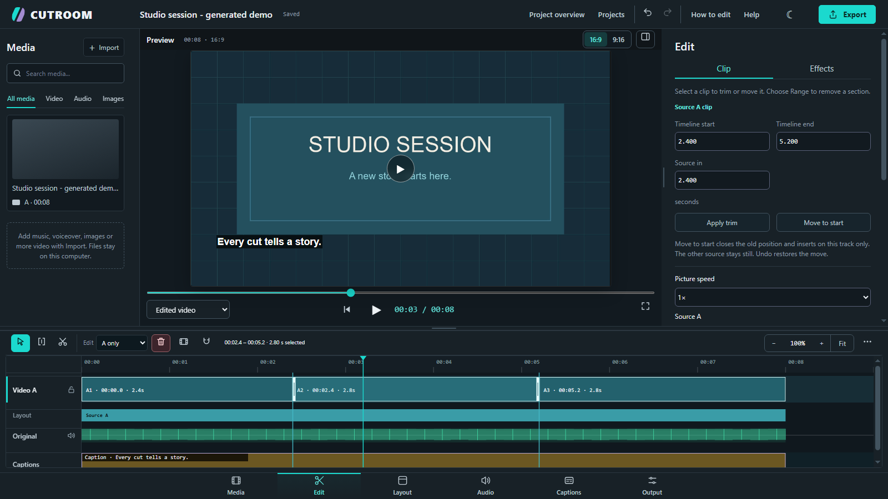
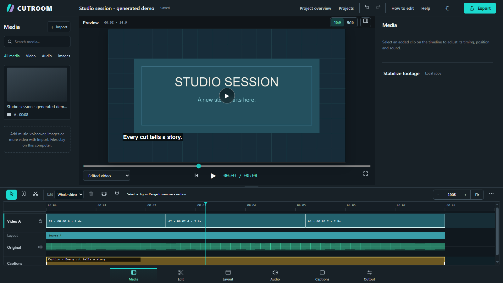
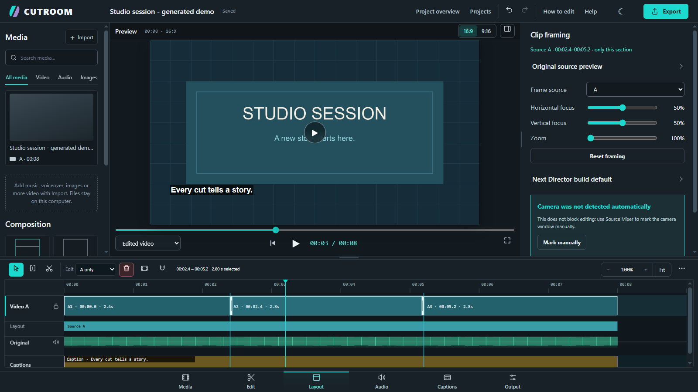
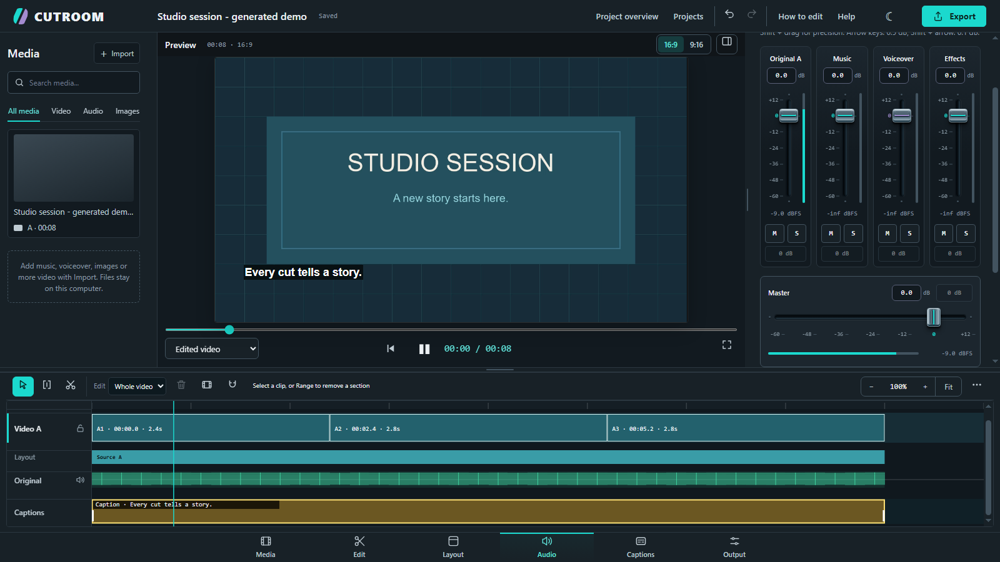
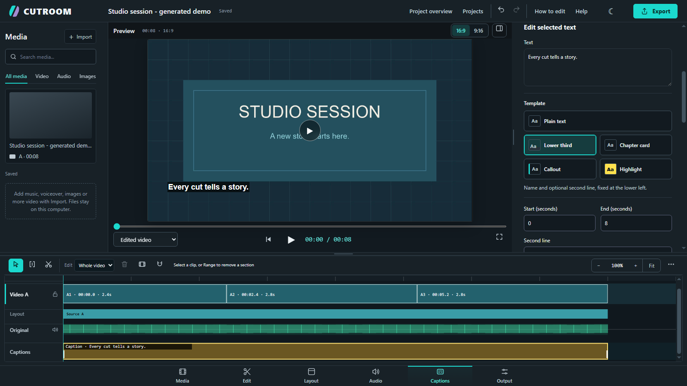
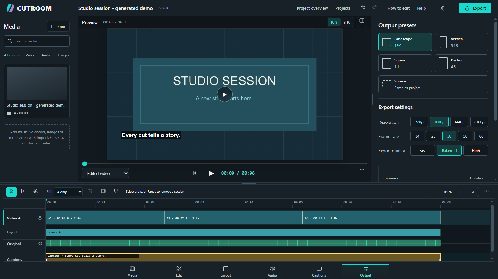
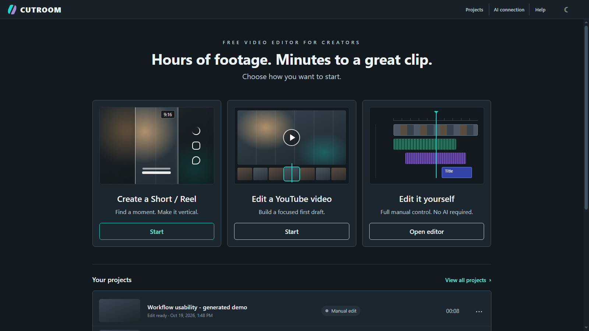

# CUTROOM

**Your footage. Your edit. On your computer.**

A free, open-source video editor for YouTube, Shorts and Reels. Cut footage, frame camera and screen, mix sound and add captions. Edit by hand, or review a first cut from optional AI.

[Download the beta](https://github.com/VanoPeradze/cutroom/releases) · [Website](https://cutroom-studio.expo.app/) · [User guide](docs/USER_GUIDE_EN.md) · [Hebrew guide](docs/README_HE.md)

*Real interface, original PNG. Click any screenshot to open that exact image at full size. These demo captures are dated 19 October 2026; the current source and downloadable beta may differ. [Screenshots and coverage](docs/GALLERY.md).*

## One edit, six workspaces

- **Media:** bring in video, images, music and voiceover.
- **Edit:** split, trim and arrange clips on independent A/B tracks, with Undo/Redo.
- **Layout:** frame a camera, screen recording or both.
- **Audio:** balance Original, Music, Voiceover, Effects and Master.
- **Captions:** add text, import SRT/VTT, and correct and style captions.
- **Output:** export a local MP4, from 720p to 4K and up to 60 FPS.

<strong>See the workspaces</strong>

<table>
<tr>
<td width="50%"> <strong>Media</strong></td>
<td width="50%"> <strong>Layout</strong></td>
</tr>
<tr>
<td> <strong>Audio</strong></td>
<td> <strong>Captions</strong></td>
</tr>
<tr>
<td> <strong>Output</strong></td>
<td> <strong>Home</strong></td>
</tr>
</table>

[AI connection and full screen inventory →](docs/GALLERY.md)

## Start editing

1. Download a **Windows or Mac beta** from the [releases page](https://github.com/VanoPeradze/cutroom/releases), then extract the entire ZIP.
2. Keep **App**, **START HERE.html** and the launcher together. Run **START CUTROOM.bat** on Windows or **START CUTROOM.command** on Mac. In a combined ZIP, open your platform's folder first.
3. Let setup finish, then open a project in your browser. Keep the launch window open while editing.

**First setup needs internet.** Python, FFmpeg and AI models are not bundled. Windows requires WinGet and the [Microsoft Visual C++ x64 runtime](https://aka.ms/vc14/vc_redist.x64.exe). The Mac launcher is unsigned. [Installation and troubleshooting](docs/PLATFORMS.md).

Running from source? Use **run_windows.bat** on Windows, the [Mac guide](https://github.com/VanoPeradze/cutroom/blob/master/docs/MAC_BETA.md), or the [Linux instructions](docs/PLATFORMS.md#linux-source-based-development-path).

## Local by default. AI if you want it.

Manual editing needs no account, API key or model. CUTROOM has no subscription or export watermark. Local AI needs separate models and suitable computer resources. Optional cloud AI uses your own provider account, with your consent; provider limits, billing and privacy terms apply. [AI setup and privacy](docs/AI_CONNECTIONS.md).

## Before you publish an edit

**1.3 Beta is still beta software.** Keep your originals, start with a short recording, and check captions, timing, sound and the exported MP4. AI drafts need review. Installation coverage and known limits belong to the [specific release](https://github.com/VanoPeradze/cutroom/releases), not these screenshots. [Beta status](docs/BETA_STATUS.md) · [Known limits](docs/QUALITY_AND_LIMITS.md).

## Guides and support

[All guides](docs/README.md) · [Keyboard shortcuts](docs/KEYBOARD_SHORTCUTS.md) · [What's new](CHANGELOG.md) · [Report a problem](https://github.com/VanoPeradze/cutroom/issues/new/choose) · [Contribute](docs/CONTRIBUTING.md)

**[MIT license](LICENSE).** Third-party tools and models retain their own [licenses](docs/THIRD_PARTY_NOTICES.md). Please report security issues through the [private security process](.github/SECURITY.md).
