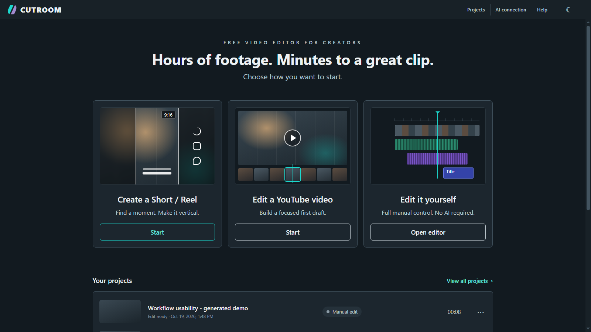
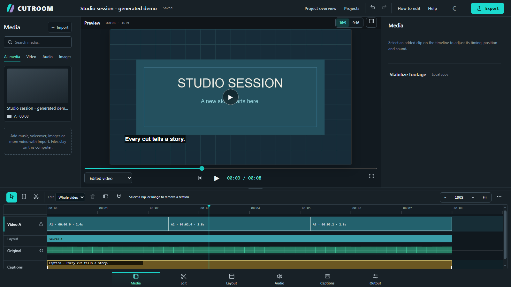
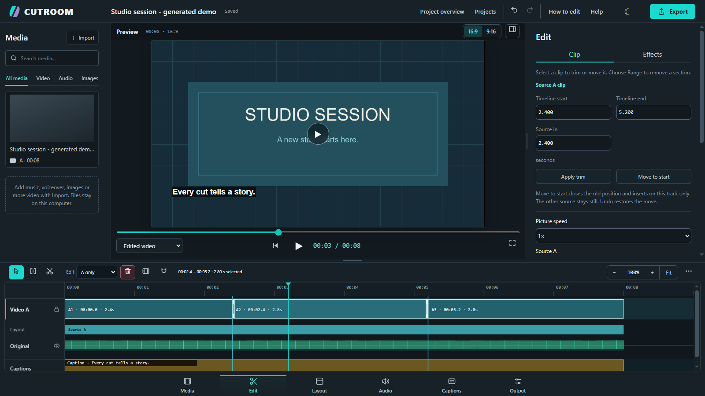
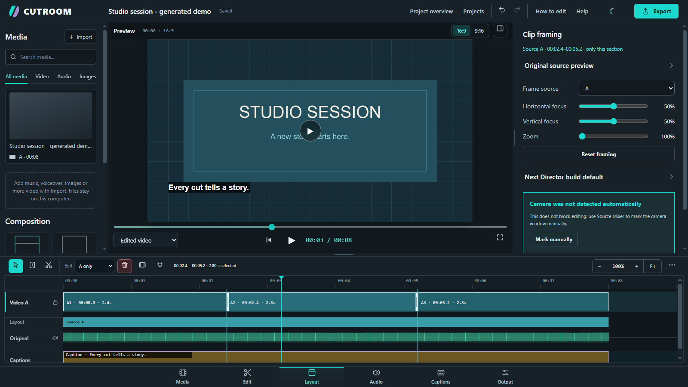
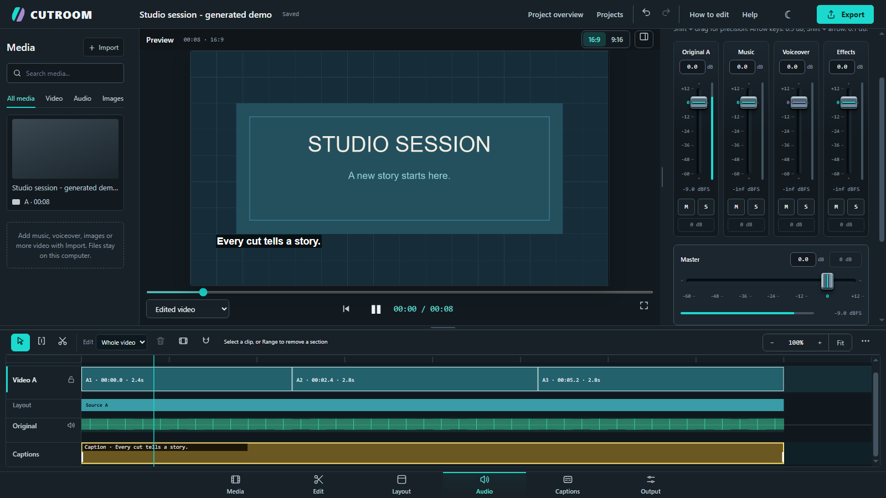
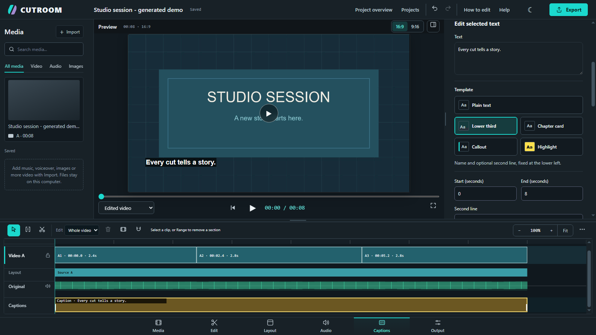
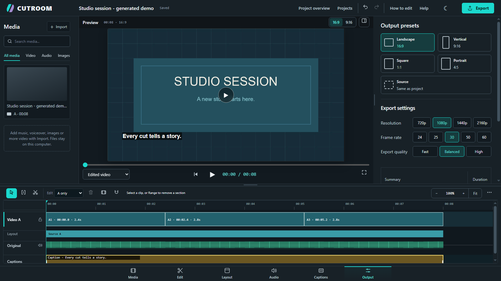
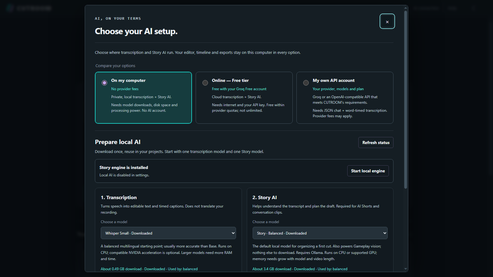
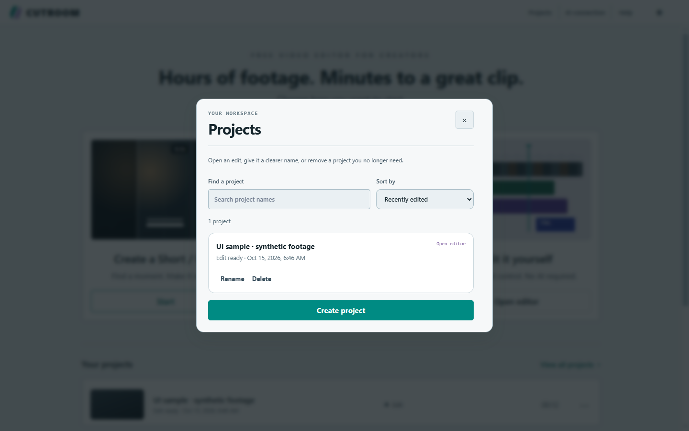
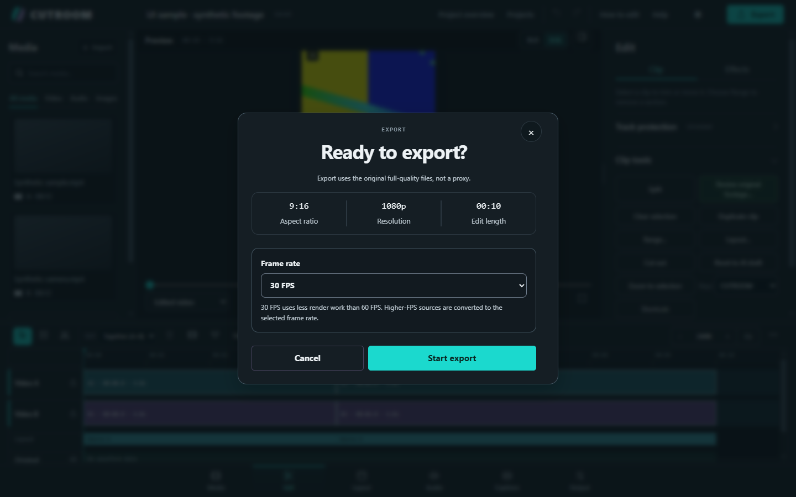

# CUTROOM screen gallery

[Back to CUTROOM](../README.md) · [User guide](USER_GUIDE_EN.md) · [עברית](README_HE.md)

Click an image to open **that exact PNG at its original resolution**. Nothing is stretched, AI-redrawn or placed inside decorative artwork.

## Capture provenance

The seven Home/workspace images were captured on **19 October 2026** at **1600 × 900**, with original STUDIO SESSION demo footage and procedural audio. The AI connection image is an existing **1600 × 900** original; its capture date is not recorded. The Projects and export images are archived **15 October 2026** files at **1440 × 900**, using a synthetic UI test project. No customer footage, personal project or API key appears in these selected files. They document the interface, not AI quality or qualification of a new release.

**This is an existing-capture gallery, not a complete capture of the current source.** The coverage list below makes the missing screens explicit. Recapture against the release candidate before presenting the gallery as current.

## Screenshots

### Home

Choose a Short / Reel, YouTube video or manual edit.

### Media

Import and organize recordings and project media.

### Edit

Trim and arrange clips with the preview and timeline in view.

### Layout

Choose a composition, frame the shot and adjust camera/screen roles.

### Audio

Balance channels with gain, mute, solo and meters.

### Captions

Work with caption text, timing and appearance.

### Output

Choose the aspect ratio, resolution, frame rate and quality.

### AI connection

Compare local and optional cloud AI. Separate models or provider accounts are required.

### Projects

Find, open, rename and manage local projects.

### Export confirmation

Review the output settings before starting an export.

## Current-source coverage checklist

Inventory checked against `web/index.html` and its workspace scripts on 7 November 2026. Confirmation and transient states are listed too, so “all windows” does not silently mean only the six bottom tabs.

| Screen or window | Existing image | Fresh capture needed |
| --- | --- | --- |
| Home | Above | Yes |
| Media, Edit, Layout, Audio, Captions, Output | Above | Yes, all six |
| AI connection: local models | Above | Yes |
| AI connection: cloud provider fields | None | Yes, with empty credentials |
| Projects | Above | Yes |
| Export confirmation | Above | Yes |
| Project preparation / import / editing request | None selected | Yes |
| Analysis progress | None selected | Yes |
| First-cut / project overview | None selected | Yes |
| Short / Reel proposals and review | None selected | Yes |
| Source review and marked ranges | None selected | Yes |
| Edit: Effects / green screen / stabilization | None selected | Yes |
| Layout: camera/screen roles, sync and speaker framing | Workspace image only | Yes, expanded controls |
| Captions: text tools and saved caption versions | Workspace image only | Yes, expanded controls |
| Keyboard shortcuts / help | None selected | Yes |
| Quick tour / how to edit | None selected | Yes |
| Rename project confirmation | None selected | Yes |
| Apply AI draft confirmation | None selected | Yes |
| Delete project confirmation | None selected | Yes, without confirming deletion |
| Export progress and finished-export review | None selected | Yes, with a disposable demo export |

## Recapture standard

- Use the real app and a separate disposable demo-data directory. Do not modify existing user projects or reuse private recordings.
- Capture in Chrome at a consistent desktop viewport, with readable text, a populated timeline and original demo media. Keep the full window visible; do not upscale a smaller screenshot.
- Show meaningful controls in each view. Capture dialog states without carrying out destructive actions or changing AI connections.
- Keep original PNGs. Make the displayed image and its full-size link point to the same file. Record capture date, source identity and viewport size with the new set.
- Verify every image visually, at original resolution, and verify the desktop/mobile website and image-viewer keyboard controls before publication.
