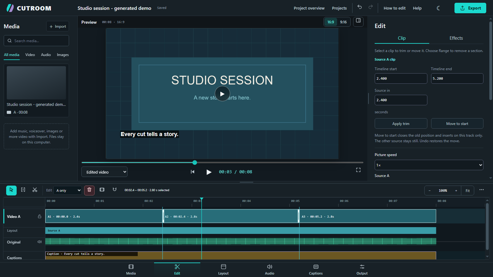

# CUTROOM

**החומרים שלך. העריכה שלך. במחשב שלך.**

עורך וידאו חינמי בקוד פתוח ל־YouTube, ל־Shorts ול־Reels. חיתוך וידאו, עיצוב הפריים, מיקס סאונד וכתוביות. אפשר לערוך ידנית, או להיעזר בטיוטת AI ולשנות אותה בעצמך.

[הורדת הבטא](https://github.com/VanoPeradze/cutroom/releases) · [האתר](https://cutroom-studio.expo.app/?lang=he) · [מדריך למשתמש](USER_GUIDE_HE.md) · [English](../README.md)

*צילום אמיתי של הממשק. לחיצה פותחת את אותה תמונת PNG בגודל המקורי. הצילומים מ־19 באוקטובר 2026; קוד המקור והבטא להורדה עשויים להיות שונים. [גלריה ורשימת החלונות](GALLERY.md).*

## שישה חלונות עבודה

- **Media:** יבוא סרטונים, תמונות, מוזיקה וקריינות.
- **Edit:** חיתוך, קיצור וסידור קליפים בערוצי A/B עצמאיים, עם ביטול ושחזור.
- **Layout:** מיקום ומסגור מצלמה, הקלטת מסך או שניהם.
- **Audio:** מיקס של המקור, מוזיקה, קריינות, אפקטים והערוץ הראשי.
- **Captions:** טקסט וכתוביות, יבוא SRT/VTT, תיקון ועיצוב.
- **Output:** יצוא MP4 מקומי, מ־720p עד 4K ועד 60 פריימים בשנייה.

[צפייה בצילומי החלונות ובחיבורי AI](GALLERY.md)

## מתחילים לערוך

1. מורידים בטא ל־Windows או ל־Mac מ[דף הגרסאות](https://github.com/VanoPeradze/cutroom/releases) ומחלצים את כל קובץ ה־ZIP.
2. משאירים את **App**, את **START HERE.html** ואת קובץ ההפעלה יחד. ב־Windows מפעילים **START CUTROOM.bat**, וב־Mac את **START CUTROOM.command**. בחבילה המשולבת פותחים קודם את תיקיית הפלטפורמה המתאימה.
3. מחכים לסיום ההתקנה ופותחים פרויקט בדפדפן. משאירים את חלון ההפעלה פתוח בזמן העבודה.

**ההתקנה הראשונה דורשת אינטרנט.** Python, FFmpeg ומודלי AI אינם כלולים בחבילה. Windows דורש WinGet ואת [Microsoft Visual C++ x64 runtime](https://aka.ms/vc14/vc_redist.x64.exe). מפעיל ה־Mac אינו חתום. [התקנה ופתרון תקלות](PLATFORMS.md).

להפעלה מקוד המקור: **run_windows.bat** ב־Windows, [מדריך Mac](https://github.com/VanoPeradze/cutroom/blob/master/docs/MAC_BETA.md), או [הוראות Linux](PLATFORMS.md#linux-source-based-development-path).

## עבודה מקומית, AI לפי בחירה

עריכה ידנית אינה דורשת חשבון, מפתח API או מודל. אין מנוי CUTROOM או סימן מים ביצוא. AI מקומי דורש הורדת מודלים ומשאבי מחשב מתאימים. AI בענן משתמש בחשבון שלך אצל ספק חיצוני ובהסכמתך; המגבלות, העלויות ותנאי הפרטיות של הספק חלים. [חיבורי AI ופרטיות](AI_CONNECTIONS.md).

## לפני שמפרסמים

**1.3 Beta היא עדיין גרסת בטא.** שומרים את קובצי המקור, מתחילים בסרטון קצר ובודקים כתוביות, תזמון, סאונד ויצוא. טיוטות AI דורשות בדיקה. מצב הבדיקות והמגבלות מפורטים ב[גרסה שהורדת](https://github.com/VanoPeradze/cutroom/releases), ולא נקבעים לפי הצילומים. [מצב הבטא](BETA_STATUS.md) · [מגבלות ידועות](QUALITY_AND_LIMITS.md).

[כל המדריכים](README.md) · [קיצורי מקלדת](KEYBOARD_SHORTCUTS.md) · [שינויים](../CHANGELOG.md) · [דיווח על תקלה](https://github.com/VanoPeradze/cutroom/issues/new/choose)

**[רישיון MIT](../LICENSE).** כלים ומודלים חיצוניים כפופים ל[רישיונות שלהם](THIRD_PARTY_NOTICES.md). לדיווח רגיש: [מדיניות אבטחה](../.github/SECURITY.md).
