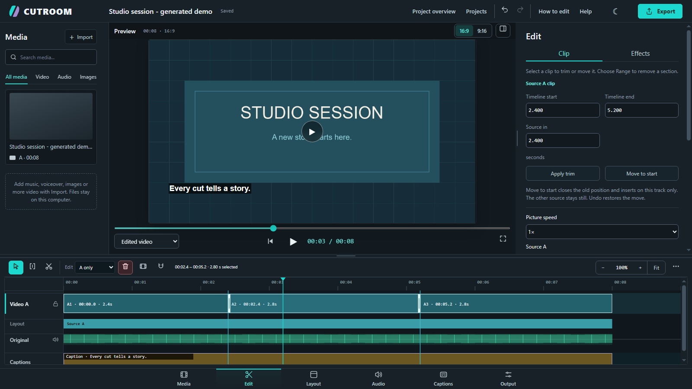

# CUTROOM 1.2 Beta

### שעות של חומר. דקות לקליפ מצוין.

עורך וידאו חינמי בקוד פתוח, שעובד במחשב שלכם. חותכים ומסדרים הקלטות, ממסגרים מצלמה ומסך, מאזנים סאונד ומוסיפים כתוביות. אפשר להתחיל ידנית או לבקש טיוטת AI ולערוך אותה.

**בלי חשבון CUTROOM ובלי סימן מים.** מודלים מקומיים ושירותי AI בענן הם אפשרויות נפרדות; שירות חיצוני עשוי להיות מוגבל או בתשלום.

[האתר](https://cutroom-studio.expo.app/) · [הורדה ל־Windows](https://github.com/VanoPeradze/cutroom/releases/download/v1.2-beta-20261019/CUTROOM-1.2-Beta-Windows-20261019.zip) · [הורדה ל־Mac](https://github.com/VanoPeradze/cutroom/releases/download/v1.2-beta-20261019/CUTROOM-1.2-Beta-Mac-20261019.zip) · [English](../README.md)

[](images/readme/studio-edit-20261019.png)

צילום אמיתי של העורך מ־**19 באוקטובר 2026**, עם כותרת STUDIO SESSION ואודיו שנוצרו במיוחד להדגמה. הוא מציג את הממשק, ולא מוכיח איכות עריכת AI.

## מה יש בעורך?

ספריית המדיה משמאל, התצוגה המקדימה במרכז, כלי הפריט שנבחר מימין והטיימליין בתחתית. לחצו על חומר גלם או על כתובית כדי לפתוח את כלי העריכה שלהם. עוצמת אודיו מיובא ניתנת לשינוי לכל קטע בנפרד; סביבת **Audio** שולטת בקבוצות המיקסר. אפשר לשנות את גודל האזורים גם במקלדת באמצעות המחיצות. בחלון צר, אזורי הכלים נגללים כדי שהפקדים יישארו נגישים.

| סביבת עבודה | מה עושים בה |
| --- | --- |
| **Media** | מוסיפים הקלטות, מוזיקה, קריינות ותמונות. חומרי המקור נשמרים. |
| **Edit** | חותכים, מקצרים ומזיזים קטעים, יחד או בערוצי A ו־B נפרדים, עם Undo/Redo ונעילת ערוצים. |
| **Layout** | בוחרים פריסת מצלמה ומסך, תמונה בתוך תמונה, חיתוך ומסגור. |
| **Audio** | מאזנים Original, Music, Voiceover, Effects ו־Master עם מדי עוצמה. Mute חל גם בייצוא; Solo מיועד לתצוגה המקדימה. |
| **Captions** | מוסיפים כותרות, מייבאים SRT/VTT ומתקנים ומעצבים תמלול אופציונלי. |
| **Output** | בוחרים צורה, רזולוציה, קצב פריימים ואיכות ומייצאים MP4 מקומי. |

הממשק באנגלית. [המדריך בעברית](USER_GUIDE_HE.md) משתמש באותם שמות כפתורים כדי שיהיה קל למצוא אותם.

## התקנה ב־Windows או ב־Mac

1. הורידו את קובץ ה־ZIP של Windows או של Mac מהקישורים למעלה.
2. חלצו את כל הקובץ ופתחו את התיקייה שמכילה את **App** ואת קובץ ההפעלה.
3. הפעילו את **START CUTROOM.bat** ב־Windows, או **START CUTROOM.command** ב־Mac, לצד תיקיית **App**.
4. כשההתקנה מסתיימת, CUTROOM נפתחת בדפדפן. השאירו את חלון ההפעלה פתוח בזמן העריכה.

ההתקנה הראשונה דורשת אינטרנט. Python, FFmpeg, מנוע Story ומודלי AI אינם מצורפים לחבילה. שמרו את **App**, את **START HERE.html** ואת קובץ ההפעלה יחד. לעדכון, חלצו עותק חדש בנפרד וגבו פרויקטים לפני העברתם.

- **Windows:** נדרשים WinGet ו[סביבת Microsoft Visual C++ x64 הרשמית](https://aka.ms/vc14/vc_redist.x64.exe) לפני ההפעלה הראשונה. המפעיל של CUTROOM אינו מתקין את סביבת Visual C++.
- **Mac:** נדרש macOS 15 ומעלה, Apple Silicon או Intel. זהו מפעיל קוד מקור שאינו חתום או מאומת ב־notarization. הוראות Python, FFmpeg והודעות האבטחה נמצאות ב[מדריך Mac](https://github.com/VanoPeradze/cutroom/blob/master/docs/MAC_BETA.md).

[מדריך הפלטפורמות](PLATFORMS.md) · [הערות הגרסה](https://github.com/VanoPeradze/cutroom/releases) · [הפעלה במחשב נוסף](TEST_ON_ANOTHER_PC.md)

אפשר להוריד גם [חבילה משולבת ל־Windows ול־Mac](https://github.com/VanoPeradze/cutroom/releases/download/v1.2-beta-20261019/CUTROOM-1.2-Beta-20261019.zip). בתוכה פותחים תחילה את **windows** או את **mac**. קובצי SHA-256 וקוד המקור המדויק מצורפים ל[גרסה המתוארכת](https://github.com/VanoPeradze/cutroom/releases/tag/v1.2-beta-20261019). [גרסת 18 באוקטובר](https://github.com/VanoPeradze/cutroom/releases/tag/v1.2-beta-20261018) נשמרת לחזרה לאחור.

## הרצה מקוד המקור

- **Windows:** הריצו `run_windows.bat` מתיקיית המאגר.
- **Mac:** עקבו אחר [מדריך ההתקנה](https://github.com/VanoPeradze/cutroom/blob/master/docs/MAC_BETA.md).
- **Linux:** אין חבילת הורדה. נדרשים Python 3.12 עם `venv` ו־`pip`, ‏Bash ו־FFmpeg/FFprobe עם תמיכה בכתוביות. הריצו:

```sh
chmod +x setup_linux.sh run_linux.sh
bash setup_linux.sh
bash run_linux.sh
```

התקנת Linux מלאה עדיין אינה מאומתת מקצה לקצה. [דרישות Linux](PLATFORMS.md#linux-source-based-development-path).

## בוחרים איך לערוך

**Manual edit** פותח את ההקלטה לעריכה בלי AI, מודל או מפתח API. ‏**YouTube video** מתחיל בעריכה אופקית, ו־**Short / Reel** בעריכה אנכית. אחרי טיוטת AI, בדקו את התמלול, את בחירת הקטעים ואת הסיום לפני שמאשרים אותה.

ב־**AI connection** אפשר לבחור מודלים מקומיים או ספק ענן תואם. מודלים מקומיים דורשים הורדה נפרדת, מקום אחסון ומשאבי עיבוד; מודל תמלול שנבחר ואינו מותקן עשוי לרדת בשימוש הראשון. Story AI דורש גם מנוע מקומי נפרד. ב־Mac התמלול המקומי עובד כרגע על המעבד.

בענן משתמשים בחשבון ובמפתח שלכם. אודיו נשלח לתמלול, וטקסט התמלול והקשר העריכה נשלחים לתכנון, לאחר בחירה והסכמה. פריימים אינם נשלחים. המכסות, החיובים ומדיניות הפרטיות של הספק חלים; מנוי לצ'אט אינו כולל בהכרח גישת API.

[חיבורי AI ופרטיות](AI_CONNECTIONS.md) · [מודלים וגודלי הורדה](MODELS.md)

## מה עדיין צריך לבדוק?

זו בטא. התחילו בסרטון קצר שאתם מכירים, שמרו את המקור וצפו ב־MP4 לפני שיתוף. בדיקות אוטומטיות וייצוא סינתטי אינם מוכיחים איכות עריכה או התקנה בכל מחשב. בדיקות מכשירים פיזיים, הודעות האבטחה של Mac ועריכה והאזנה מייצגות באנגלית ובעברית עדיין דורשות קבלה ידנית.

בשתי הקלטות, בדקו ששני המקורות מציגים את אותו רגע לפני שמסתמכים על סנכרון אוטומטי. המצלמה מופיעה רק במקום שבו יש כיסוי בערוץ שלה. ערוץ B ריק אינו יוצר צילום מצלמה; בדיקת זיהוי או ייצוא מבוקר אינה קובעת את הסנכרון של ההקלטות שלכם.

[מגבלות הבטא](BETA_STATUS.md) · [מגבלות ואיכות](QUALITY_AND_LIMITS.md) · [בדיקות קבלה ידניות](https://github.com/VanoPeradze/cutroom/blob/master/packaging/REVIEW_ACCEPTANCE.md)

## עזרה, משוב ורישיון

[פתחו דיווח תקלה](https://github.com/VanoPeradze/cutroom/issues/new/choose) עם מערכת הפעלה, דפדפן ושלבי שחזור. הסירו מידע אישי ואל תצרפו חומר לקוחות או מפתחות. [מדריך המשוב](BETA_FEEDBACK.md) מסביר מה מועיל לצרף.

CUTROOM מופצת ברישיון [MIT](../LICENSE). לכלים ולמודלים חיצוניים [רישיונות משלהם](THIRD_PARTY_NOTICES.md).

[מדריך מלא](USER_GUIDE_HE.md) · [כל התיעוד](README.md) · [English](../README.md)
