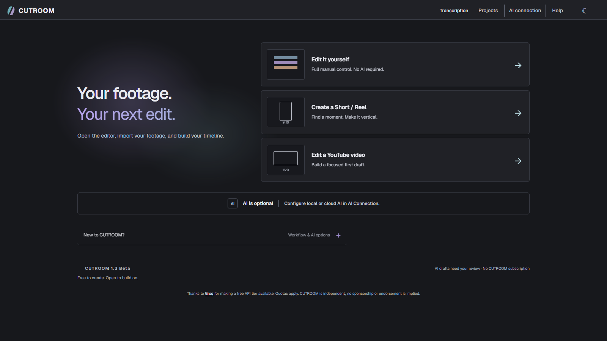
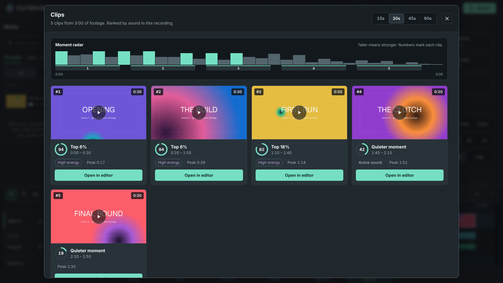

# CUTROOM

**עורך וידאו חינמי בקוד פתוח להקלטות, ליוטיוב, ל־Shorts ול־Reels.**
אפשר לחתוך, למסגר, לערבב סאונד ולהוסיף כתוביות במחשב. מתחילים ידנית או בונים טיוטה בעזרת AI ומחליטים מה נשאר.

[הורדה ל־Windows או ל־Mac](https://cutroom-studio.expo.app/?lang=he#download) · [גרסאות ב־GitHub](https://github.com/VanoPeradze/cutroom/releases) · [מדריך למשתמש](USER_GUIDE_HE.md) · [English](../README.md)

## הממשק

כל תמונה נפתחת בלחיצה כקובץ ה־PNG המקורי בגודל מלא. אלו צילומים אמיתיים של CUTROOM מפרויקט בדיקה ריק או מחומר הדגמה סינתטי. [כל המסכים ותאריכי הצילום](GALLERY.md).

<table dir="rtl">
  <tr>
    <td> מסך הבית</td>
    <td> העורך</td>
  </tr>
  <tr>
    <td> סגנונות עריכה</td>
    <td> לוח קליפים</td>
  </tr>
</table>

## מה אפשר לעשות

- **עריכה ידנית:** לקצר ולסדר קליפים, למסגר וידאו, לערבב אודיו ולהוסיף כתוביות. לא צריך חשבון או AI.
- **Clips:** לבדוק הצעות באורך 15, 30, 45 או 60 שניות ולייצא טווח אחד או כמה טווחים שמופיעים בציר הזמן, כקובצי MP4 למחשב. אפשר להעתיק כותרות, תיאור והאשטגים. CUTROOM לא מפרסם ברשתות.
- **טיוטות AI:** לבחור Shorts, קטעי שיחה או סרטון יוטיוב ארוך. בקוד המקור הזה הסגנונות מקובצים לחמש משפחות. מפת וידאו אופציונלית מעריכה אירועי קול וחילופי דוברים, אבל התוצאות והפרקים המוצעים עדיין דורשים בדיקה.

## התחלה מהירה

1. הורידו את **CUTROOM 1.3 Beta** [מהאתר](https://cutroom-studio.expo.app/?lang=he#download) וחלצו את כל ה־ZIP לתיקייה חדשה.
2. ב־Windows הפעילו `START CUTROOM.bat`. ב־Mac פתחו את `mac` מתוך ה־ZIP המשולב והפעילו `START CUTROOM.command` לצד התיקייה `App`. [Linux זמין להתקנה מהמקור](PLATFORMS.md#linux-source-based-development-path).
3. בחרו **Edit it yourself**, פתחו סרטון, ערכו קטע קצר וייצאו אותו. שמרו את חומר המקור ובדקו את ה־MP4 לפני פרסום.

ההתקנה הראשונה דורשת אינטרנט. תמלול מקומי ו־Story AI משתמשים במודלים נפרדים; חיבור AI לענן הוא בחירה. הערת הרקע ומפת הווידאו המפורטת נשארות מקומיות. [חיבורי AI](AI_CONNECTIONS.md) · [גבולות הבטא](BETA_STATUS.md) · [יומן שינויים](../CHANGELOG.md)

גרסת הבטא בקוד פתוח ברישיון [MIT](../LICENSE).
